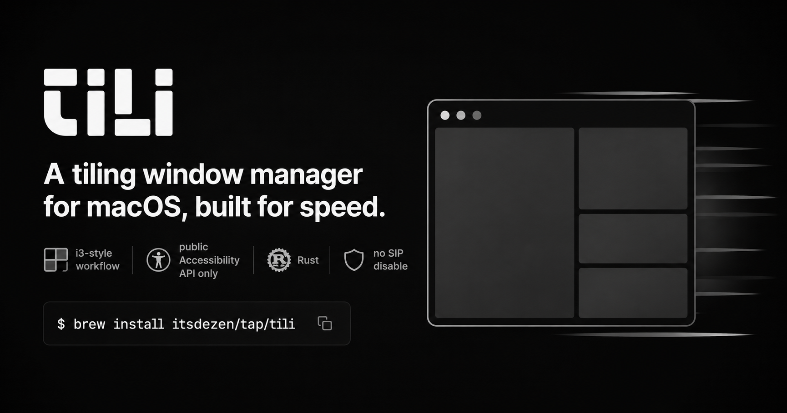

<div align="center">


# tili

**A tiling window manager for macOS, built for speed.**

i3-style workflow · public Accessibility API only · Rust · no SIP disable

[](https://github.com/itsdezen/tili/actions/workflows/ci.yml)
[](LICENSE)
[](https://www.rust-lang.org)
[](https://github.com/itsdezen/tili/releases)

[Website](https://tili.dezen.me) · [Getting started](#getting-started) · [Commands](#commands) · [Roadmap](ROADMAP.md) · [Contributing](#contributing) · [Architecture](#architecture)

### Install tili

```sh
brew install itsdezen/tap/tili
```

[](https://github.com/sponsors/itsdezen)
[](https://buymeacoffee.com/itsdezen)



</div>

---

## Why tili

tili is built around the details that matter once it is part of a daily
workflow: state that survives a restart, workspaces that know where they
belong, rules that can see the whole window, and placement that happens the
moment a window appears.

- **Event-driven.** The daemon subscribes to Accessibility and workspace
  notifications and reacts to them, so it does no work while your windows
  aren't changing.
- **Public API only.** Exactly one narrowly-scoped private call is used
  anywhere in the codebase (to resolve a window's real `CGWindowID`) —
  everything else is the public Accessibility API. You never disable System
  Integrity Protection to run tili.
- **Session restore, down to the special states.** Layout, focus, the active
  workspace on each monitor, floating geometry, and special states — native
  fullscreen, minimized, hidden app — survive a restart or crash.
- **Native-tab guard.** App-owned tabs (Finder, Terminal, Ghostty) stay
  inside the app: opening, closing, or switching a tab never creates a
  placement or relayouts the workspace.
- **Display-aware workspaces.** Every workspace has a home display:
  `workspace X` goes there, `workspace-here X` pulls it to the focused
  display, and `move-workspace-to-monitor next|prev|main` relocates it.
  Inactive workspaces park together at the southeast-most display's corner,
  and every connected display gets an active workspace, with synthetic
  fallbacks cleaned up after their windows migrate.
- **Window rules that see the whole window.** Match `app-id`, title regex,
  AX `role`, and `subrole`; route a window to a workspace; choose `float`,
  `tile`, or `ignore`; and size floating windows absolutely or by ratio with
  optional centering. Workspace rules route an app's first window by
  default, with `always` for every new window, and `tili rule` writes a
  ready-to-paste rule for the focused window.
- **Opt-in animation.** Moves are instant by default. Turn on `animate` for
  an eased transition with a configurable duration (`animate-duration-ms`,
  120ms by default), including a new window's entry into its slot.
- **Placement at window creation.** A new window joins the layout the moment
  it appears, so placement doesn't wait for a later refresh.
- **Mouse drag-resize.** Drag a tile's edge or corner to resize it; the result
  snaps to the same grid as keyboard resizes (`mouse-resize-step`).
- **KDL configuration, hot reloaded.** Workspaces, keybinding modes, and
  floating rules nest the way they actually relate, and saving the file
  applies changes live.
- **Menu bar workspace badge.** `tili-menubar` ships with the daemon and
  shows the active workspace on the focused monitor, without a second status
  bar app.
- **Signed releases through Homebrew.** The tap installs a signed `tili.app`;
  tili is MIT licensed and released through Homebrew.

## Status

tili is at `v0.15.0` and already daily-drivable: tiling, workspaces,
hot-reloaded config, built-in hotkeys, window rules (role/subrole,
float/tile/ignore, floating geometry), multi-monitor (home-display workspace
flow, global southeast parking, monitor-pinned workspaces, display-aware
fallback workspaces), mouse/focus-follows-monitor, session restore, opt-in
animation, JSON query/subscribe, a native-tab guard, a menu bar workspace
badge, and a real signed release pipeline. See [ROADMAP.md](ROADMAP.md) for
what's planned next.
Pre-1.0 still means config schema and CLI surface can change between
releases — check [CHANGELOG.md](CHANGELOG.md) when upgrading.

## Getting started

```sh
tili start
```

That's it — `tili start` installs a background LaunchAgent (auto-restart,
auto-start at login) and **waits** for tili-daemon to actually finish
starting before returning. Ctrl-C stops the wait without affecting the
daemon, which keeps running independently under launchd. First run:
- Triggers the **Accessibility permission** prompt, then the **Input
  Monitoring** one — grant both whenever you get to it; tili waits (up to
  a minute) and reports "running" the moment you do, no restart needed. If
  you don't grant Accessibility within that minute (or interrupt the wait
  yourself), the daemon stops itself cleanly and `tili start` reports
  that — just run it again once you're ready.
- Writes a starter config to `~/.config/tili/tili.kdl` if none exists yet
  — edit it and save, no restart needed, changes hot-reload. See
  [`example/tili.kdl`](example/tili.kdl) for the full commented version.

Use the keybindings from your config (or the `tili` CLI directly — see
[Commands](#commands) below) to focus/move/tile windows. Run `tili stop`
to stop it and remove the LaunchAgent (so it stays stopped until you run
`tili start` again), `tili status` to check whether it's running, and
`tili --version`/`tili help` for the installed version and full command
list.

### Session state

tili saves managed layout, focus, floating geometry, special states, and
active workspace per monitor to
`~/Library/Application Support/tili/session.json` (versioned, atomic write,
`0600`, with a `.bak`). Disable it with `session { enabled #false }` in
`~/.config/tili/tili.kdl`; `tili uninstall` removes both files. The state
contains window titles and bundle ids but no window content.

### JSON query and subscriptions

```sh
tili query state --json          # full snapshot: monitors, workspaces, windows
tili query windows --json
tili subscribe --json            # one JSON event per line until interrupted
```

`query state` is versioned (`"version": 1`) and includes each window's
`bundle_id`, `workspace`, `focused`, `role`, and `subrole` alongside its
placement and frame. `subscribe` emits a compact `"snapshot"` event first,
then a `"state_changed"` event with a monotonic `seq` whenever state
changes — enough for a status bar without reserializing every window.

`tili rule` prints a ready-to-paste `floating-rules` snippet for the
focused window; `--workspace <name>` emits a `workspace-rules` snippet,
and `--copy` puts it on the clipboard.

> [!TIP]
> If a three-finger swipe up (Mission Control) shows tiled windows at
> tiny or wildly mismatched sizes, enable **Group windows by
> application** under **System Settings → Desktop & Dock → Mission
> Control** — this is a macOS Mission Control layout setting, not
> something tili controls.

### Multi-monitor

Every connected display gets an active workspace at startup (not just the
main one). A workspace can be pinned with
`workspace "entertain" monitor="main"` or `monitor="12"`; pinned workspaces
are never assigned to another display, including while that display is
temporarily disconnected.

If every declared workspace is already in use, tili creates a temporary
fallback workspace for the display, displayed by its pretty name
(`Sidecar Display`, `DELL U2720Q`) or `Display 2`/`Display 3` when the
monitor reports no name. Empty fallbacks disappear when the display
disconnects; a non-empty one has its windows moved to the main/focused
workspace before cleanup, so no window is silently closed or orphaned.

Each workspace has a **home display** — the display currently showing it, a
connected `monitor="..."` pin, or the display it last lived on. A workspace
used for the first time is assigned to the focused display, so it still feels
local. `tili workspace <name>` always goes to that home (focusing the display
if the workspace is already visible there, or showing it there and parking the
display's previous workspace). It never materializes a parked workspace on an
unrelated display.

Use `tili workspace-here <name>` to change the display you are on: it pulls the
workspace here, swapping with whatever this display currently shows.
`tili move-workspace-to-monitor next|prev|main` pushes the active workspace to
another display (swapping with its occupant); moving a parked workspace only
changes its home, so the target's screen is untouched. `tili workspace-back`
returns to the previous `(display, workspace)` pair rather than following a
workspace that may have moved.

Parking is global: every inactive workspace's windows sit at the bottom-right
corner of the southeast-most display, and are re-parked whenever displays
connect/disconnect or the arrangement changes. This keeps parked windows from
ever appearing on another monitor, including in diagonal arrangements, at the
cost of moving them between displays when you switch workspaces.

## Menu bar badge

`tili start` also installs and starts `tili-menubar` alongside the daemon —
a small `NSStatusItem` badge showing the active workspace on your focused
monitor. An auto-created display fallback is shown by the monitor's pretty
name (`Sidecar Display`, `DELL U2720Q`, or `Display 2`). Click the badge to
switch workspaces, copy a rule snippet for the focused window, open your
config file, or quit (which stops the daemon too). It starts/stops/uninstalls automatically with
`tili start`/`stop`/`uninstall`, so there's nothing extra to run, and it
hides itself entirely whenever the daemon isn't reachable rather than
showing stale state.

## Other ways to install

`brew install itsdezen/tap/tili` above is the recommended path — it
installs a real, signed `tili.app` via
[itsdezen/homebrew-tap](https://github.com/itsdezen/homebrew-tap).

Building from source instead:

```sh
git clone https://github.com/itsdezen/tili
cd tili
cargo build --release --workspace
```

Or grab a prebuilt `tili.app` directly from a
[GitHub release](https://github.com/itsdezen/tili/releases) without
Homebrew. Releases are codesigned (see
[CONTRIBUTING.md](CONTRIBUTING.md#release-engineering)) but not notarized
yet, so Gatekeeper will still prompt on first launch — right-click → Open,
or `xattr -d com.apple.quarantine tili.app`.

## Preview: config

Configuration is [KDL](https://kdl.dev), read from `~/.config/tili/tili.kdl`
and hot-reloaded on save. This is a trimmed example — see
[`example/tili.kdl`](example/tili.kdl) for the full, commented,
copy-pasteable version:

```kdl
workspaces {
    workspace "work"
    workspace "entertain" layout="accordion" monitor="main"
    workspace "random"
}

gaps {
    inner 4
    outer 8 8 8 8
}

settings {
    auto-reload #true
    mouse-follows-focus #false
    focus-follows-monitor #false
    ax-timeout-ms 500
    native-tabs #true
}

keybindings mode="main" {
    bind "alt-h" "focus left"
    bind "alt-shift-h" "move left"
    bind "alt-w" "workspace work"
    bind "alt-ctrl-w" "workspace-here work"
    bind "alt-ctrl-comma" "move-workspace-to-monitor prev"
    bind "alt-ctrl-period" "move-workspace-to-monitor next"
    bind "alt-ctrl-m" "move-workspace-to-monitor main"
    bind "alt-slash" "layout toggle"
    bind "alt-shift-f" "toggle-floating"
    bind "alt-m" "focus-monitor"
}

floating-rules {
    rule app-id="com.apple.finder"
    rule app-id="com.apple.systempreferences" { width 900; height 600; center #true }

    defaults { center #true; width 800; height 600 }
}
```

## Commands

`tili start`/`stop`/`uninstall`/`status` manage the daemon's LaunchAgent itself;
everything else below is a client command sent over a Unix socket to a
daemon that's already running — the same commands are also what
keybindings in your config resolve to (e.g. `bind "alt-h" "focus left"`).

| Command | What it does |
|---|---|
| `tili` (no subcommand) | Same as `tili start`, after an Enter-key confirmation |
| `tili start` | Install and start tili-daemon as a background LaunchAgent (auto-restart, auto-start at login) |
| `tili stop` | Stop tili-daemon and remove its LaunchAgent |
| `tili uninstall` | Full teardown: stop the daemon, remove its config/logs/socket, and reset the Accessibility grant |
| `tili status` | Report whether the daemon is running |
| `tili ping` | Check the daemon is reachable (scripting-friendly; see `status`) |
| `tili --version`/`-V` | Print the installed version |
| `tili help` | Print the full command list (same as `--help`/`-h`) |
| `tili focus <left\|right\|up\|down>` | Move focus to the window in that direction |
| `tili move <left\|right\|up\|down>` | Move the focused window one step in that direction, re-parenting it through the tree |
| `tili join <left\|right\|up\|down>` | Wrap the focused window and its neighbor into a new, perpendicular container |
| `tili resize <amount>` | Grow (positive) or shrink (negative) the focused window's share of its nearest tiled container |
| `tili balance [--root]` | Reset child weights of the focused container (or workspace root) evenly |
| `tili layout <toggle\|tiles\|accordion\|horizontal\|vertical\|toggle-orientation> [--root]` | Toggle or set the focused container's layout/orientation |
| `tili flatten` | Re-normalize the tree (no-op today — normalization already runs after every mutation) |
| `tili fullscreen [--native]` | Toggle the focused window fullscreen (tiled, or `--native` for a separate Space) |
| `tili close` | Close the focused window (best-effort) |
| `tili summon <query>` | Focus (and raise) the first known window whose title or bundle id matches `query` |
| `tili set-floating <on\|off>` | Set the focused window's tiled/floating placement |
| `tili toggle-floating` | Flip the focused window between tiled and floating |
| `tili query [state\|windows\|workspaces\|monitors] [--json]` | Print a machine-readable JSON snapshot |
| `tili subscribe [--json]` | Stream JSON state events until interrupted |
| `tili rule [--workspace <name>] [--copy]` | Print/copy a rule snippet for the focused window |
| `tili workspace <name>` | Go to the workspace's home display (or focus the display already showing it) |
| `tili workspace-here <name>` | Switch the focused display to the workspace, pulling/swapping it here |
| `tili workspace-back` | Return to the previous display+workspace pair |
| `tili move-to-workspace <name>` | Move the focused window to another workspace |
| `tili move-workspace-to-monitor <next\|prev\|main\|id> [--workspace <name>]` | Push a workspace to another monitor without switching focus; active workspaces swap, parked ones only change home |
| `tili list-workspaces` | List workspaces, with active/monitor markers |
| `tili focus-monitor [target]` | Cycle monitors, or focus `main`, `next`, `prev`, or a display id |
| `tili list-monitors` | List connected monitors |
| `tili list-windows` | List known windows (tiled/floating, frame, pid) |

## Architecture

tili is a Cargo workspace split along strict boundaries so the hardest parts
(the container tree, the layout algorithms) can be tested without a Mac at
all, and the parts that touch the OS (`AXUIElement`, `NSWorkspace`, display
reconfiguration) stay isolated in one place.

```
crates/
├── tili-tree     pure container-tree + layout algorithms (Tiles/BSP, Accordion)
├── tili-ax        Accessibility API integration, the WindowFrameSetter seam
├── tili-config    KDL parsing + validation, hot-reload
├── tili-ipc        shared daemon/CLI protocol types
├── tili-daemon     the window manager: event loop, state, hotkeys
├── tili-cli        the `tili` command-line client
└── tili-menubar    the menu bar workspace badge
```

The daemon is single-threaded around one piece of state: every command,
whether it comes from a global hotkey or the CLI over a Unix socket, flows
through the same `dispatch(&mut WmState, Command) -> Response` function. No
locks, no drift between "what the hotkey does" and "what the CLI does."

Workspaces are virtual — macOS exposes no public API to control Spaces, so
inactive-workspace windows are parked off-screen rather than relying on real
Spaces, the same technique other public-API-only tools in this space use.

## Contributing

tili is early enough that architectural feedback is as valuable as code.
Check [ROADMAP.md](ROADMAP.md) for what's planned — each item there is
scoped to be independently pickup-able. See [CONTRIBUTING.md](CONTRIBUTING.md)
for dev setup, the pre-PR test gate, and the design invariants PRs are
expected to respect. Bug reports and feature requests use the issue
templates; general questions go in
[Discussions](https://github.com/itsdezen/tili/discussions).

Releases ship continuously as features land — see
[`.github/workflows/release.yml`](.github/workflows/release.yml) and
[CHANGELOG.md](CHANGELOG.md) for the process and versioning convention.

## Security

Found a vulnerability? See [SECURITY.md](SECURITY.md) — please don't open a
public issue for security reports.

## Code of Conduct

This project follows the [Contributor Covenant](CODE_OF_CONDUCT.md).

## Acknowledgments

tili exists because [AeroSpace](https://github.com/nikitabobko/AeroSpace) is
great and I wanted an excuse to rewrite it in Rust anyway. Not because Rust
is faster (it isn't, meaningfully) — just because Cargo, the type system,
and shipping one static binary make for a nicer afternoon than I was
having otherwise. Thank you, AeroSpace, for existing. 🙏

tili is fully open for contributions — issues, PRs, "this config option
should really work differently," all of it welcome.

## License

[MIT](LICENSE)
